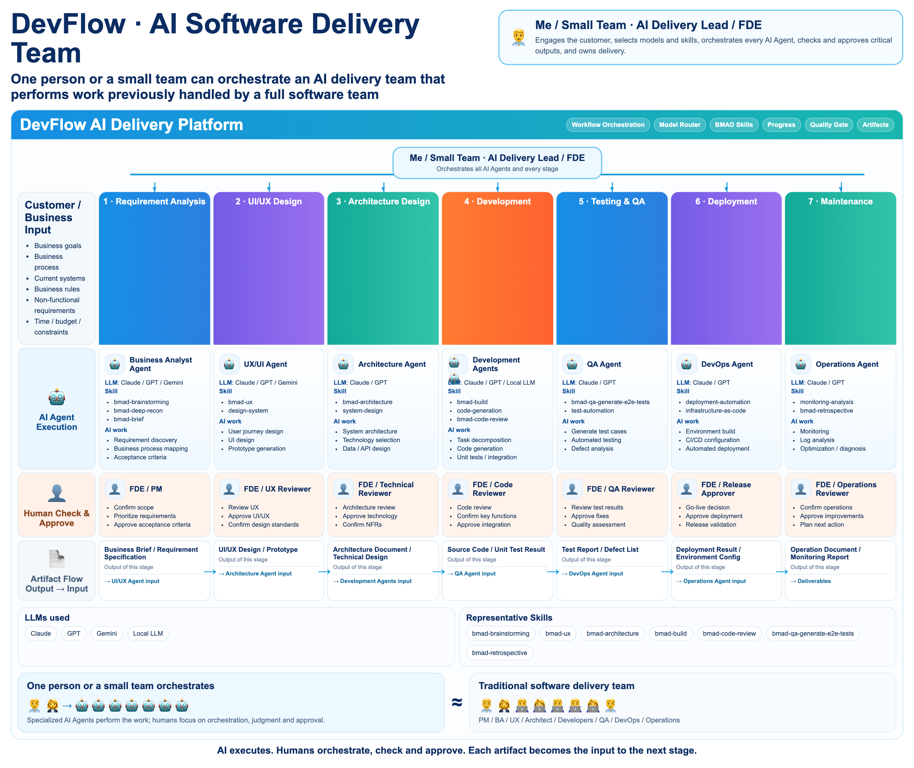
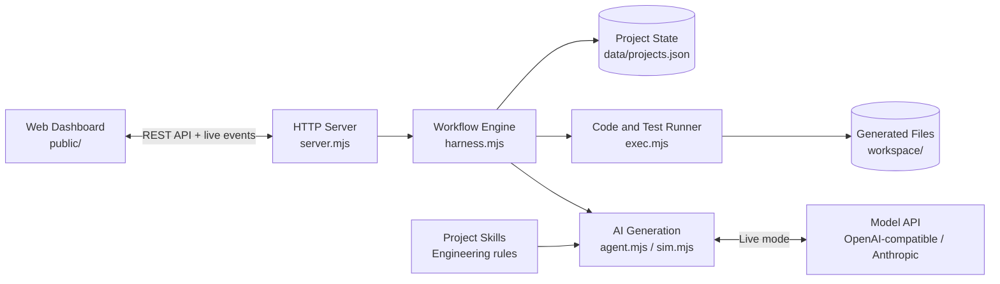
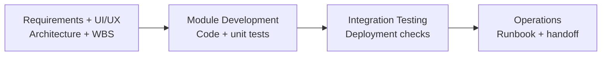

# AI Dev Platform

**A visual workspace for AI-assisted software delivery.**

Coordinate specialized AI agents while people guide the work, review outputs, and approve each handoff.



[HTML overview](docs/DevFlow_AI_Delivery_Team_EN_v2.html) · [View the full-size image](docs/assets/devflow-ai-delivery-team.png)

Turn a project brief into requirements, designs, a development plan, code, tests, and an operations runbook. Follow progress in a web dashboard and review each step before the workflow continues.

The platform runs locally on Node.js with no npm dependencies. Generated code and test results are saved to your workspace.

## What you can do

- **Plan a project:** generate requirements, UI/UX designs, architecture, and a work breakdown structure (WBS).
- **Build and test:** generate modules in parallel and run their tests with Node.js, Java, or Python. SAP CAP projects also receive CDS validation.
- **Review the results:** approve deliverables or reject them with feedback for another attempt.
- **Inspect the output:** browse and edit documents, source files, test results, and activity logs.
- **Choose your workflow:** use presets for web apps, websites, services, command-line tools, and data projects.
- **Guide the AI:** import project skills and select a model for each stage.

## Architecture



The workflow engine coordinates stages, review gates, and module development. The AI adapter generates content; the execution layer writes files and runs tests. The HTTP server connects these components to the dashboard and streams progress updates.

## Delivery workflow

The full workflow has eight stages, grouped below:



In **human_gate** mode, each stage waits for approval. Each module must have passing test results before it can be approved. Rejection sends feedback to the model for a new attempt. **auto** mode approves completed steps automatically while keeping the test requirements.

The deployment stage runs validation checks and generates release guidance. Deployment to external infrastructure depends on the generated project's release process.

## Progress and languages

Execution progress appears in the top bar, pipeline stages, and module list/details. Percentages follow execution checkpoints (preparation, generation, file output, and tests), rather than elapsed time. Model calls keep their last confirmed percentage while awaiting a response. Failed attempts retain their last checkpoint in red; retries start at zero. Development progress averages all modules. A task at 100% has finished executing and may still require human approval.

The supported display languages are Japanese and English; Japanese is the default, including fallback for legacy locale preferences. Preset skills and generated templates use Japanese or English. Model prompts require Japanese prose with English technical identifiers, and exclude model reasoning from displayed artifacts. Generated Python bytecode caches are omitted from the source browser.

## Quick start

Requires **Node.js 20 or later**. Use **Node.js 22 or later** for browser checks and screenshots.

This is the private development repository. Continue using your existing local checkout; a new clone is only needed when setting up another working copy. Changing the Git remote leaves local configuration, project data, and generated workspaces in place. These files are excluded from Git.

For a new working copy, use a GitHub account with access to this private repository:

```bash
git clone https://github.com/winds198912121/ai-platform-private.git ai-platform
cd ai-platform
```

### Run with a model

```bash
AI_PLATFORM_PROVIDER=live node server.mjs
```

Open [http://127.0.0.1:8788](http://127.0.0.1:8788) and configure **LLM Providers** before creating a project: enter the provider's API key, enable and save it, then select it as the default provider. The presets include OpenAI, Claude, DeepSeek, and MiniMax. Provider settings are saved locally in `data/settings.json` and are excluded from Git.

Stage-specific provider/model selections take priority over the saved default provider. If neither is available, an environment-only configuration can supply an OpenAI-compatible endpoint. Set both the key and Base URL; for example:

```bash
export AI_PLATFORM_PROVIDER=live
export AI_PLATFORM_API_KEY="your-api-key"
export AI_PLATFORM_BASE_URL="https://api.deepseek.com/v1"
export AI_PLATFORM_MODEL="deepseek-v4-flash"
node server.mjs
```

Create a project and review the deliverables as each stage completes.

### Try the offline demo

```bash
AI_PLATFORM_PROVIDER=sim node server.mjs
```

Offline mode uses templates instead of model calls. Generated module tests still run locally.

### Check the installation

```bash
bash setup/install.sh check
bash tools/run_all.sh
```

The verification script runs unit tests, offline end-to-end tests, and browser checks. Browser checks require Chrome and are skipped when it is unavailable.

## Documentation

| Guide | Contents |
|---|---|
| [Setup and configuration](setup/README.md) | Prerequisites, environment variables, start/stop commands, and troubleshooting |
| [Platform guide](docs/platform-guide.md) | Workflow presets, language support, review rules, skills, workspace layout, and API reference |
